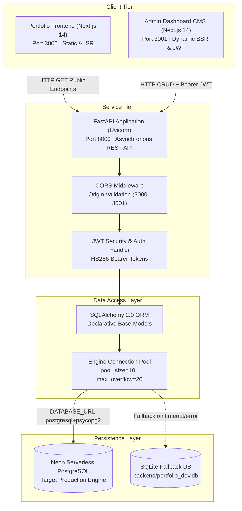
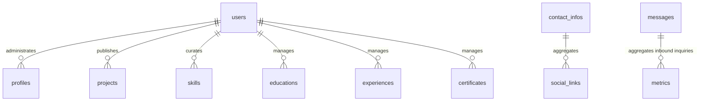
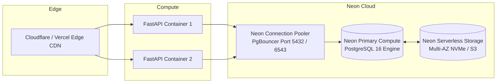

# Database Architecture & Data Layer Specification

**Document Version:** 1.0.0  
**Date:** November 7, 2026  
**Author:** Senior Database Engineer  
**Project:** Portfolio CMS & VS Code Web Platform  

---

## Table of Contents

- [1. Architectural Overview](#1-architectural-overview)
- [2. Component Responsibilities](#2-component-responsibilities)
- [3. Database Connection Flow](#3-database-connection-flow)
- [4. SQLAlchemy ORM Models & Field Specifications](#4-sqlalchemy-orm-models--field-specifications)
- [5. Entity-Relationship (ER) Schema](#5-entity-relationship-er-schema)
- [6. Environment Variables & Configuration](#6-environment-variables--configuration)
- [7. Production Architecture & Scaling Strategy](#7-production-architecture--scaling-strategy)

---

## 1. Architectural Overview

The Portfolio CMS platform adopts a decoupled three-tier architecture comprising a modern client tier, an asynchronous REST API service tier, and a cloud-native relational data persistence layer:



---

## 2. Component Responsibilities

### 2.1 Client Tier
* **Portfolio Frontend (`frontend/`):** Consumes read-only public endpoints (`/api/v1/projects`, `/api/v1/skills`, `/api/v1/education`, etc.) to render the interactive VS Code developer interface. Features Incremental Static Regeneration (ISR) and client-side tab state caching.
* **Admin Dashboard (`admin-dashboard/`):** Full-featured content management dashboard. Authenticates administrators via `/api/v1/auth/login`, stores JWT access tokens in client cookies/session, and performs full CRUD operations against all portfolio entities.

### 2.2 Service Tier (`backend/app/`)
* **FastAPI Router (`app/api/v1/api.py`):** Dispatches versioned REST endpoints with automated OpenAPI / Swagger documentation (`/docs`).
* **Pydantic Validation Layer (`app/schemas/`):** Strictly enforces request payload types, string lengths, and email formatting before touching the database session.
* **Authentication & Authorization (`app/core/security.py`):** Encrypts credentials with `bcrypt` password hashing and issues stateless HS256 JWT access tokens with configurable expiration (default: 1440 minutes / 24 hours).

### 2.3 Data Access Tier (`backend/app/db/`)
* **Declarative Base (`app/db/base.py`):** Centralizes model registry, enabling automatic DDL schema synchronization via `Base.metadata.create_all(bind=engine)`.
* **Session Lifecycle (`app/db/session.py`):** Provides a scoped dependency injector (`get_db()`) utilizing the Python generator pattern (`yield db`) ensuring connections are closed after each request.

---

## 3. Database Connection Flow

The database connection engine is managed in [`backend/app/db/session.py`](file:///c:/Users/Data%20Science/Documents/Project%20Done/my_vscode_portfolio/backend/app/db/session.py):

```python
def get_engine():
    db_url = settings.DATABASE_URL
    if db_url.startswith("sqlite"):
        if "portfolio_dev.db" in db_url:
            return create_engine(f"sqlite:///{DEV_SQLITE_PATH}", connect_args={"check_same_thread": False})
        return create_engine(db_url, connect_args={"check_same_thread": False})
    
    try:
        engine = create_engine(
            db_url,
            pool_pre_ping=True,
            pool_size=10,
            max_overflow=20,
            connect_args={"connect_timeout": 3}
        )
        with engine.connect() as conn:
            pass
        return engine
    except Exception as e:
        logger.warning(f"PostgreSQL connection error: {e}. Falling back to SQLite at {DEV_SQLITE_PATH}.")
        return create_engine(f"sqlite:///{DEV_SQLITE_PATH}", connect_args={"check_same_thread": False})
```

### Key Connection Features:
1. **`pool_pre_ping=True`:** Emits a lightweight `SELECT 1` ping before borrowing a pooled connection from Neon. This handles serverless scale-to-zero scenarios where stale connections are dropped by Neon after idle periods.
2. **`pool_size=10, max_overflow=20`:** Allocates a baseline of 10 persistent connections with capacity to burst up to 30 concurrent connections during high-traffic intervals.
3. **`connect_timeout=3`:** Enforces a strict 3-second network barrier. If the remote database is unreachable, the application falls back immediately to SQLite without hanging worker processes.

---

## 4. SQLAlchemy ORM Models & Field Specifications

The application schema is defined across 11 standalone SQLAlchemy models in `backend/app/models/`:

### 4.1 User Model (`users`)
Managed in [`backend/app/models/user.py`](file:///c:/Users/Data%20Science/Documents/Project%20Done/my_vscode_portfolio/backend/app/models/user.py)

| Column | Type | Constraints | Description |
| :--- | :--- | :--- | :--- |
| `id` | `Integer` | `primary_key=True`, auto-increment | Unique user identifier |
| `email` | `String(255)` | `unique=True`, `index=True`, `nullable=False` | Admin login email address |
| `full_name` | `String(255)` | `nullable=True` | Administrator full name |
| `avatar_url` | `String(500)` | `nullable=True` | Profile image path or CDN URL |
| `hashed_password` | `String(255)` | `nullable=False` | Bcrypt hashed password |
| `role` | `Enum(UserRole)` | `default=UserRole.ADMIN`, `nullable=False` | Role-based permission (`admin`, `editor`, `viewer`) |
| `is_active` | `Boolean` | `default=True`, `nullable=False` | Account active flag |
| `created_at` | `DateTime` | `default=UTC`, `nullable=False` | Creation timestamp |
| `updated_at` | `DateTime` | `default=UTC`, `onupdate=UTC`, `nullable=False` | Last modification timestamp |

### 4.2 Profile Model (`profiles`)
Managed in [`backend/app/models/profile.py`](file:///c:/Users/Data%20Science/Documents/Project%20Done/my_vscode_portfolio/backend/app/models/profile.py)

| Column | Type | Constraints | Description |
| :--- | :--- | :--- | :--- |
| `id` | `Integer` | `primary_key=True`, auto-increment | Profile primary key |
| `name` | `String(100)` | `default="Punlork"`, `nullable=False` | Short name / callout |
| `full_name` | `String(255)` | `default="Punlork Sok"`, `nullable=False` | Full professional name |
| `role` | `String(255)` | `default="Full-Stack & Python Developer"`, `nullable=False` | Primary engineering title |
| `status` | `String(255)` | `default="Available for projects"`, `nullable=False` | Real-time working status |
| `avatar_url` | `String(500)` | `default="/images/profile.png"`, `nullable=True` | Avatar image source path |
| `bio` | `Text` | `nullable=True` | Detailed introductory bio |
| `tech_stack` | `String(1000)`| `default=""`, `nullable=False` | Primary skill summary keywords |
| `main_line` | `String(255)` | `default="Hi! I'm Punlork."`, `nullable=False` | Primary greeter header |
| `typed_lines` | `Text` | `default='["I\'m a Full-Stack Developer."]'`, `nullable=False` | JSON array of typewriter phrases |
| `quick_navigation`| `Text` | `default="[]"`, `nullable=False` | JSON array of quick navigation tabs |
| `updated_at` | `DateTime` | `default=UTC`, `onupdate=UTC`, `nullable=False` | Last update timestamp |

### 4.3 Project Model (`projects`)
Managed in [`backend/app/models/project.py`](file:///c:/Users/Data%20Science/Documents/Project%20Done/my_vscode_portfolio/backend/app/models/project.py)

| Column | Type | Constraints | Description |
| :--- | :--- | :--- | :--- |
| `id` | `Integer` | `primary_key=True`, auto-increment | Project primary key |
| `title` | `String(255)` | `index=True`, `nullable=False` | Project title |
| `slug` | `String(255)` | `unique=True`, `index=True`, `nullable=False` | URL-safe slug |
| `description` | `Text` | `nullable=False` | Comprehensive project summary |
| `category` | `String(100)` | `default="Web App"`, `index=True`, `nullable=False` | Project category |
| `tags` | `String(500)` | `default=""`, `nullable=False` | Comma-separated tech tags |
| `demo_url` | `String(500)` | `nullable=True` | Live deployment link |
| `github_url` | `String(500)` | `nullable=True` | Source code repository link |
| `image_url` | `String(500)` | `nullable=True` | Preview banner image |
| `is_featured` | `Boolean` | `default=False`, `nullable=False` | Flag to display on hero highlights |
| `order` | `Integer` | `default=0`, `nullable=False` | Sort index for UI display |
| `created_at` | `DateTime` | `default=UTC`, `nullable=False` | Creation timestamp |
| `updated_at` | `DateTime` | `default=UTC`, `onupdate=UTC`, `nullable=False` | Last update timestamp |

### 4.4 Skill Model (`skills`)
Managed in [`backend/app/models/skill.py`](file:///c:/Users/Data%20Science/Documents/Project%20Done/my_vscode_portfolio/backend/app/models/skill.py)

| Column | Type | Constraints | Description |
| :--- | :--- | :--- | :--- |
| `id` | `Integer` | `primary_key=True`, auto-increment | Skill record ID |
| `name` | `String(100)` | `index=True`, `nullable=False` | Skill name (e.g., Python, Next.js) |
| `category` | `String(100)` | `default="Frontend"`, `index=True`, `nullable=False` | Category (Frontend, Backend, etc.) |
| `proficiency` | `Integer` | `default=80`, `nullable=False` | Proficiency percentage (1-100) |
| `icon` | `String(100)` | `default="code"`, `nullable=False` | Icon name or font-awesome identifier |
| `order` | `Integer` | `default=0`, `nullable=False` | Display sort order |
| `created_at` | `DateTime` | `default=UTC`, `nullable=False` | Creation timestamp |

### 4.5 Education Model (`educations`)
Managed in [`backend/app/models/education.py`](file:///c:/Users/Data%20Science/Documents/Project%20Done/my_vscode_portfolio/backend/app/models/education.py)

| Column | Type | Constraints | Description |
| :--- | :--- | :--- | :--- |
| `id` | `Integer` | `primary_key=True`, auto-increment | Education record ID |
| `institution` | `String(255)` | `nullable=False` | University or school name |
| `degree` | `String(255)` | `nullable=False` | Degree, diploma, or track |
| `field_of_study`| `String(255)`| `nullable=True` | Academic major |
| `start_date` | `String(100)` | `nullable=False` | Year or date started |
| `end_date` | `String(100)` | `nullable=True` | Graduation year or "Present" |
| `grade` | `String(100)` | `nullable=True` | GPA or academic honors |
| `description` | `Text` | `nullable=True` | Coursework or achievement details |
| `url` | `String(500)` | `nullable=True` | Institution or verification link |
| `order` | `Integer` | `default=0`, `nullable=False` | Sort display index |
| `created_at` | `DateTime` | `default=UTC`, `nullable=False` | Creation timestamp |
| `updated_at` | `DateTime` | `default=UTC`, `onupdate=UTC`, `nullable=False` | Last modification timestamp |

### 4.6 Experience Model (`experiences`)
Managed in [`backend/app/models/experience.py`](file:///c:/Users/Data%20Science/Documents/Project%20Done/my_vscode_portfolio/backend/app/models/experience.py)

| Column | Type | Constraints | Description |
| :--- | :--- | :--- | :--- |
| `id` | `Integer` | `primary_key=True`, auto-increment | Experience record ID |
| `company` | `String(255)` | `nullable=False` | Employer or organization name |
| `position` | `String(255)` | `nullable=False` | Job title |
| `location` | `String(255)` | `nullable=True` | Work location or "Remote" |
| `employment_type`| `String(100)`| `default="Full-time"`, `nullable=False`| Employment arrangement |
| `start_date` | `String(100)` | `nullable=False` | Start year/month |
| `end_date` | `String(100)` | `nullable=True` | End year/month or "Present" |
| `is_current` | `Boolean` | `default=False`, `nullable=False` | Active employment flag |
| `description` | `Text` | `nullable=True` | Responsibilities and accomplishments |
| `technologies` | `String(500)` | `default=""`, `nullable=False` | Comma-separated tech stack |
| `company_url` | `String(500)` | `nullable=True` | Company website URL |
| `order` | `Integer` | `default=0`, `nullable=False` | Display order |
| `created_at` | `DateTime` | `default=UTC`, `nullable=False` | Creation timestamp |
| `updated_at` | `DateTime` | `default=UTC`, `onupdate=UTC`, `nullable=False` | Last modification timestamp |

### 4.7 Certificate Model (`certificates`)
Managed in [`backend/app/models/certificate.py`](file:///c:/Users/Data%20Science/Documents/Project%20Done/my_vscode_portfolio/backend/app/models/certificate.py)

| Column | Type | Constraints | Description |
| :--- | :--- | :--- | :--- |
| `id` | `Integer` | `primary_key=True`, auto-increment | Certificate record ID |
| `title` | `String(255)` | `nullable=False` | Certification name |
| `issuer` | `String(255)` | `nullable=False` | Issuing authority (e.g., Meta, Google) |
| `issue_date` | `String(100)` | `nullable=True` | Date or year issued |
| `expiration_date`| `String(100)`| `nullable=True` | Expiry date or "No Expiration" |
| `credential_id`| `String(255)` | `nullable=True` | Verification credential ID |
| `credential_url`| `String(500)`| `nullable=True` | Online verification badge URL |
| `image_url` | `String(500)` | `nullable=True` | Certificate badge image path |
| `description` | `Text` | `nullable=True` | Certificate syllabus summary |
| `order` | `Integer` | `default=0`, `nullable=False` | Display order index |
| `created_at` | `DateTime` | `default=UTC`, `nullable=False` | Creation timestamp |
| `updated_at` | `DateTime` | `default=UTC`, `onupdate=UTC`, `nullable=False` | Last modification timestamp |

### 4.8 Contact Info Model (`contact_infos`)
Managed in [`backend/app/models/contact.py`](file:///c:/Users/Data%20Science/Documents/Project%20Done/my_vscode_portfolio/backend/app/models/contact.py)

| Column | Type | Constraints | Description |
| :--- | :--- | :--- | :--- |
| `id` | `Integer` | `primary_key=True`, auto-increment | Contact info ID |
| `developer_name`| `String(255)`| `default="Punlork"`, `nullable=False` | Display name |
| `professional_title`| `String(255)`| `default="Full-Stack & Python Developer"`, `nullable=False` | Main title |
| `email` | `String(255)` | `default="sokpunlork586@gmail.com"`, `nullable=False` | Contact inbox |
| `phone` | `String(100)` | `nullable=True` | Phone or WhatsApp number |
| `location` | `String(255)` | `default="Cambodia"`, `nullable=False` | Physical country/city |
| `timezone` | `String(100)` | `default="ICT (UTC+7)"`, `nullable=False` | Standard timezone |
| `preferred_method`| `String(100)`| `default="Email"`, `nullable=False` | Preferred inquiry channel |
| `response_window`| `String(100)`| `default="Within 24 hours"`, `nullable=False` | SLA response duration |
| `availability_status`| `String(100)`| `default="Available for projects"`, `nullable=False` | Current contract availability |
| `github_url` | `String(500)` | `default="https://github.com/sokpunlork586-tech"`, `nullable=False` | GitHub profile link |
| `linkedin_url` | `String(500)` | `default="https://linkedin.com"`, `nullable=False` | LinkedIn profile link |
| `bio_note` | `Text` | `nullable=True` | Optional contact instructions |
| `updated_at` | `DateTime` | `default=UTC`, `onupdate=UTC`, `nullable=False` | Last modification timestamp |

### 4.9 Social Link Model (`social_links`)
Managed in [`backend/app/models/contact.py`](file:///c:/Users/Data%20Science/Documents/Project%20Done/my_vscode_portfolio/backend/app/models/contact.py)

| Column | Type | Constraints | Description |
| :--- | :--- | :--- | :--- |
| `id` | `Integer` | `primary_key=True`, auto-increment | Social link record ID |
| `platform` | `String(100)` | `nullable=False` | Platform name (e.g., GitHub, Twitter) |
| `url` | `String(500)` | `nullable=False` | Destination web link |
| `icon` | `String(100)` | `default="faLink"`, `nullable=False` | FontAwesome icon token |
| `username` | `String(100)` | `default=""`, `nullable=False` | Display username or handle |
| `order` | `Integer` | `default=0`, `nullable=False` | Display order index |
| `is_visible` | `Boolean` | `default=True`, `nullable=False` | Visibility toggle |
| `created_at` | `DateTime` | `default=UTC`, `nullable=False` | Creation timestamp |
| `updated_at` | `DateTime` | `default=UTC`, `onupdate=UTC`, `nullable=False` | Last modification timestamp |

### 4.10 Message Model (`messages`)
Managed in [`backend/app/models/message.py`](file:///c:/Users/Data%20Science/Documents/Project%20Done/my_vscode_portfolio/backend/app/models/message.py)

| Column | Type | Constraints | Description |
| :--- | :--- | :--- | :--- |
| `id` | `Integer` | `primary_key=True`, auto-increment | Message primary key |
| `name` | `String(255)` | `nullable=False` | Sender name |
| `email` | `String(255)` | `nullable=False` | Sender email |
| `subject` | `String(255)` | `nullable=False` | Message topic/subject |
| `message` | `Text` | `nullable=False` | Inbound message content |
| `is_read` | `Boolean` | `default=False`, `nullable=False` | Read indicator flag |
| `is_archived` | `Boolean` | `default=False`, `nullable=False` | Archive status flag |
| `created_at` | `DateTime` | `default=UTC`, `nullable=False` | Arrival timestamp |

### 4.11 Metric Model (`metrics`)
Managed in [`backend/app/models/analytics.py`](file:///c:/Users/Data%20Science/Documents/Project%20Done/my_vscode_portfolio/backend/app/models/analytics.py)

| Column | Type | Constraints | Description |
| :--- | :--- | :--- | :--- |
| `id` | `Integer` | `primary_key=True`, auto-increment | Metric primary key |
| `metric_name` | `String(100)` | `index=True`, `nullable=False` | Metric key (e.g. `page_views`) |
| `metric_value`| `Float` | `default=0.0`, `nullable=False` | Metric measurement value |
| `change_pct` | `Float` | `default=0.0`, `nullable=False` | Percentage change vs prior cycle |
| `period` | `String(50)` | `default="month"`, `nullable=False` | Interval scope (`day`, `month`, `year`) |
| `updated_at` | `DateTime` | `default=UTC`, `onupdate=UTC`, `nullable=False` | Last evaluation timestamp |

---

## 5. Entity-Relationship (ER) Schema

The logical relationship structure is intentionally decoupled. Many portfolio entities act as autonomous, flat collections optimized for rapid JSON serialization to the frontend:



---

## 6. Environment Variables & Configuration

### 6.1 Configuration Model (`backend/app/core/config.py`)
FastAPI reads configuration using `pydantic-settings.BaseSettings`:

```python
class Settings(BaseSettings):
    PROJECT_NAME: str = "Portfolio Admin Backend"
    API_V1_STR: str = "/api/v1"
    SECRET_KEY: str
    ALGORITHM: str = "HS256"
    ACCESS_TOKEN_EXPIRE_MINUTES: int = 60 * 24  # 1 day

    DATABASE_URL: str
    BACKEND_CORS_ORIGINS: List[str] = [
        "http://localhost:3000",
        "http://localhost:3001",
        "http://127.0.0.1:3000",
        "http://127.0.0.1:3001",
    ]
```

### 6.2 Comparison: Development vs. Production

| Environment Variable | Local Development (Current) | Neon Production (Recommended) |
| :--- | :--- | :--- |
| `DATABASE_URL` | `sqlite:///./portfolio_dev.db` | `postgresql+psycopg2://<user>:<password>@<ep-xyz>.neon.tech/<dbname>?sslmode=require` |
| `SECRET_KEY` | Development placeholder string | 64-character cryptographically random secret |
| `BACKEND_CORS_ORIGINS` | `["http://localhost:3000", "http://localhost:3001"]` | Specific production domains (`https://portfolio.com`, `https://admin.portfolio.com`) |
| `ACCESS_TOKEN_EXPIRE_MINUTES` | `1440` (24 Hours) | `60` (1 Hour with refresh rotation) |

---

## 7. Production Architecture & Scaling Strategy



### 7.1 Benefits of Neon PostgreSQL for this Architecture:
1. **Serverless Scale-to-Zero:** Reduces operational hosting expenses by pausing compute resources when the portfolio receives no traffic, resuming in under 500ms upon incoming requests.
2. **Built-in Connection Pooling (PgBouncer):** Neon provides pooled endpoints (port 5432 or 6543) that absorb spikes in concurrent FastAPI worker threads without exceeding database connection limits.
3. **Database Branching:** Allows instant copy-on-write database clones for preview deployments, staging environments, and safe schema migrations without risking production data.
4. **Automated Point-in-Time Recovery (PITR):** Enables rolling back the database state to any specific second within the retention window if accidental deletion occurs during CMS operations.
