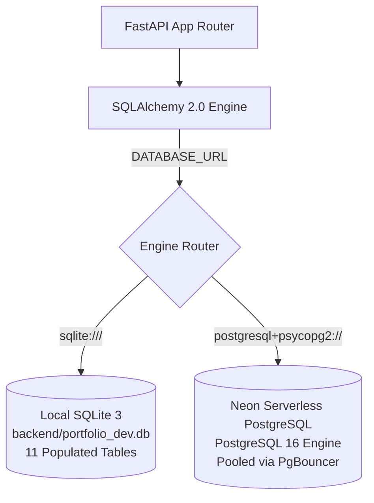

# Database Management & Schema Operations Guide

**Document Version:** 2.0.0  
**Applied Project:** Portfolio CMS & VS Code Web Platform (`my_vscode_portfolio`)  
**Universal Standard:** Relational Database Lifecycle, ORM Management & Cloud Migration  
**Date:** November 7, 2026  

---

## Table of Contents

- [1. Database Strategy & Architecture Overview](#1-database-strategy--architecture-overview)
- [2. Dual-Engine Failover Architecture](#2-dual-engine-failover-architecture)
- [3. Master Table Catalog & Schema Reference](#3-master-table-catalog--schema-reference)
- [4. Connection String Management](#4-connection-string-management)
- [5. Database Migrations & ETL Sync](#5-database-migrations--etl-sync)
- [6. Seeding Behavior vs. Data Migration](#6-seeding-behavior-vs-data-migration)
- [7. Neon Serverless PostgreSQL Optimization](#7-neon-serverless-postgresql-optimization)
- [8. Maintenance, Vacuuming & Indexing](#8-maintenance-vacuuming--indexing)
- [9. Universal Reusability Notes](#9-universal-reusability-notes)

---

## 1. Database Strategy & Architecture Overview

The platform uses an ORM-first relational database architecture designed to support zero-dependency local development via **SQLite 3** while seamlessly scaling to cloud-native **Neon Serverless PostgreSQL** for production.



For complete field specifications, ER diagrams, and connection pooling details, refer to [DATABASE_ARCHITECTURE.md](file:///c:/Users/Data%20Science/Documents/Project%20Done/my_vscode_portfolio/docs/DATABASE_ARCHITECTURE.md).

---

## 2. Dual-Engine Failover Architecture

Implemented in [`backend/app/db/session.py`](file:///c:/Users/Data%20Science/Documents/Project%20Done/my_vscode_portfolio/backend/app/db/session.py):

* **Circuit Breaker:** If a PostgreSQL connection attempt exceeds the 3-second `connect_timeout`, the engine automatically logs a warning and binds to the local SQLite database.
* **Connection Pre-Ping (`pool_pre_ping=True`):** Emits a test `SELECT 1` query prior to checking out pooled connections. This transparently handles Neon's scale-to-zero serverless wakeups without throwing broken pipe errors to users.

---

## 3. Master Table Catalog & Schema Reference

The active database schema contains 11 core tables:

| # | Table Name | SQLAlchemy Model | Purpose | Verified Row Count |
| :---: | :--- | :--- | :--- | :---: |
| 1 | `users` | `User` | Administrator and editor authentication | **2** |
| 2 | `profiles` | `Profile` | Hero section mainline, typewriter phrases, bio | **1** |
| 3 | `projects` | `Project` | Showcase software projects and tech tags | **4** |
| 4 | `skills` | `Skill` | Technical proficiency sliders and badges | **7** |
| 5 | `educations` | `Education` | Academic history, apprenticeships, honors | **2** |
| 6 | `experiences` | `Experience` | Professional career milestones and roles | **2** |
| 7 | `certificates`| `Certificate` | Industry credentials and verification links | **3** |
| 8 | `contact_infos`| `ContactInfo`| Contact channels, location, availability | **1** |
| 9 | `social_links` | `SocialLink` | Social platform profiles and links | **3** |
| 10| `messages` | `Message` | Client contact inquiries from visitors | **3** |
| 11| `metrics` | `Metric` | Dynamic analytics telemetry measurements | **0** |

---

## 4. Connection String Management

### 4.1 SQLite Configuration
```ini
DATABASE_URL="sqlite:///./portfolio_dev.db"
```

### 4.2 Neon Cloud PostgreSQL Configuration
```ini
DATABASE_URL="postgresql+psycopg2://<username>:<password>@<endpoint-id>-pooler.<region>.aws.neon.tech/<dbname>?sslmode=require"
```

> [!CAUTION]
> Neon enforces SSL connections. Omitting `?sslmode=require` will result in connection rejection (`no pg_hba.conf entry for host ... no encryption`).

---

## 5. Database Migrations & ETL Sync

For detailed instructions on backing up SQLite and transferring all 23 live records to Neon PostgreSQL, consult [DATABASE_MIGRATION_GUIDE.md](file:///c:/Users/Data%20Science/Documents/Project%20Done/my_vscode_portfolio/docs/DATABASE_MIGRATION_GUIDE.md).

### Quick ETL Migration Command:
```powershell
cd backend
$env:PYTHONPATH="."
python migrate_sqlite_to_neon.py
```

---

## 6. Seeding Behavior vs. Data Migration

A common misconception in this architecture is the role of `backend/seed.py`:

* **`seed.py` is NOT an ETL migration script.**
* It only initializes tables via `Base.metadata.create_all(bind=engine)` and adds factory mock records if tables are empty.
* It completely omits the `Profile` model (`profiles` table).
* To move existing data to Neon without loss, always use the automated migration script detailed in the migration guide.

---

## 7. Neon Serverless PostgreSQL Optimization

1. **Use Pooled Endpoints:** Always connect FastAPI to Neon's `-pooler` endpoint on port `5432` or `6543`. This engages Neon's hosted PgBouncer to manage concurrent serverless connections efficiently.
2. **Handle Cold Starts:** Ensure `pool_pre_ping=True` is enabled in SQLAlchemy so the driver waits for Neon's compute node to resume from scale-to-zero state (typically ~500ms).

---

## 8. Maintenance, Vacuuming & Indexing

### 8.1 PostgreSQL Maintenance Commands
When connected to Neon PostgreSQL, periodic vacuuming optimizes performance:

```sql
-- Analyze table statistics for the query planner
ANALYZE;

-- Reclaim storage from dead tuples
VACUUM;
```

### 8.2 Verifying Indexes
Confirm that indexes on unique slugs, emails, and categories exist:
```sql
SELECT tablename, indexname, indexdef 
FROM pg_indexes 
WHERE schemaname = 'public';
```

---

## 9. Universal Reusability Notes

To adapt this database guide for another project:
1. Update Section 3 with your entity-relationship models.
2. Adjust Section 4 if utilizing other cloud database providers (e.g. Supabase, AWS RDS, PlanetScale, CockroachDB).
3. Preserve the pre-ping connection pattern and failover architecture.
