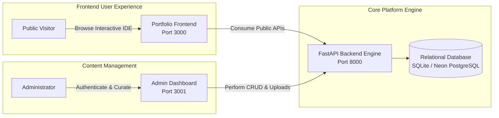

# Project Overview & System Catalog

**Document Version:** 2.0.0  
**Applied Project:** Portfolio CMS & VS Code Web Platform (`my_vscode_portfolio`)  
**Universal Standard:** Reusable for Full-Stack Web & Headless CMS Platforms  
**Date:** November 7, 2026  

---

## Table of Contents

- [1. Mission & Vision](#1-mission--vision)
- [2. System Capabilities & Feature Matrix](#2-system-capabilities--feature-matrix)
- [3. Complete Technology Stack](#3-complete-technology-stack)
- [4. Monorepo Structure & File Mapping](#4-monorepo-structure--file-mapping)
- [5. User Personas & Workflows](#5-user-personas--workflows)
- [6. Verification & Implementation Status](#6-verification--implementation-status)
- [7. Universal Reusability Notes](#7-universal-reusability-notes)

---

## 1. Mission & Vision

The **Portfolio CMS & VS Code Web Platform** is an interactive, full-stack developer portfolio and content management system modeled after the **Visual Studio Code IDE** and **Atom One Dark** theme.

Its primary engineering goal is to decouple developer portfolio content from hardcoded static assets or source code commits, enabling administrators to manage, curate, and publish all professional records (projects, career history, education, certifications, bio, and social links) dynamically through a web workbench.



---

## 2. System Capabilities & Feature Matrix

### 2.1 Public Portfolio Frontend (`frontend/`)
* **VS Code UI Simulation:** Authentic editor workbench featuring Activity Bar, Explorer Sidebar, tabbed document switching, status bar, and integrated pseudo-terminal.
* **Deterministic JSS Theme:** Dynamic CSS generation with content-based DJB2 hashing to eliminate SSR/CSR hydration mismatches.
* **Responsive Layout:** Automatically collapses navigation drawer on mobile viewports (< 768px) with click-outside backdrop dismissal.
* **Dynamic Content Sync:** Consumes live profile, projects, and career milestones from the FastAPI backend with instant fallback to static markdown if the backend is offline.

### 2.2 Admin Content Management Dashboard (`admin-dashboard/`)
* **Role-Based Authentication (RBAC):** Secure login interface powered by JWT bearer tokens with permission enforcement (`admin`, `editor`, `viewer`).
* **Complete CRUD Modules:** Dedicated interfaces for Projects, Skills, Work Experience, Education, Certifications, Contact Details, Social Links, and Profile Hero copy.
* **Telemetry & Traffic Visuals:** Recharts dashboard charting visits, inquiries, and platform metrics with live status indicators.
* **Media Uploads:** Multi-part file upload support for project screenshots and avatars stored under `backend/uploads/`.

### 2.3 Backend API Engine (`backend/`)
* **Asynchronous REST Architecture:** FastAPI framework powered by Uvicorn ASGI with auto-generated OpenAPI 3.0 / Swagger documentation (`/docs`).
* **Resilient Database Layer:** Dual-engine SQLAlchemy 2.0 configuration with 3-second connection timeout and graceful fallback from PostgreSQL to SQLite.
* **Password Encryption & Tokens:** Industry-standard `bcrypt` password hashing and stateless HS256 JWT tokens.

---

## 3. Complete Technology Stack

| Layer | Technology | Version | Purpose in Project |
| :--- | :--- | :---: | :--- |
| **Frontend Framework** | **Next.js (App Router)** | `14.2.24` | Public portfolio server-side rendering & ISR |
| **Frontend Styling** | **React-JSS + CSS Modules** | `10.10.0` | VS Code Atom One Dark styling tokens |
| **Admin Framework** | **Next.js (App Router)** | `14.2.15` | Admin CMS dashboard workbench |
| **Admin Styling** | **Tailwind CSS + Lucide Icons**| `3.4.14` | Fast, utility-first CMS responsive interface |
| **Backend Framework** | **FastAPI** | `>=0.115.0` | Asynchronous high-performance REST API |
| **ASGI Web Server** | **Uvicorn (Standard)** | `>=0.30.0` | Production HTTP server |
| **ORM / Data Access** | **SQLAlchemy** | `>=2.0.35` | Object Relational Mapping & query builder |
| **Database Driver** | **psycopg2-binary** | `>=2.9.9` | High-speed C-based PostgreSQL driver |
| **Data Validation** | **Pydantic v2** | `>=2.9.0` | Strict request/response schema parsing |
| **Security & Auth** | **PyJWT + Bcrypt** | `>=2.9.0` | Cryptographic token creation & password hashing |
| **Local Database** | **SQLite 3** | `3.x` | Zero-dependency local developer database |
| **Cloud Database** | **Neon PostgreSQL** | `16.x` | Serverless production-ready database target |
| **Testing Harness** | **Jest + Testing Library** | `30.x` | Frontend component unit & snapshot tests |
| **Backend Testing** | **Pytest + HTTPX** | `8.x` | API integration and endpoint validation |

---

## 4. Monorepo Structure & File Mapping

```text
my_vscode_portfolio/
├── admin-dashboard/            # Next.js 14 Admin CMS Application
│   ├── src/
│   │   ├── app/                # Next.js App Router subpages
│   │   │   ├── certificates/   # Certificate credentials manager
│   │   │   ├── contact/        # Contact details & social link manager
│   │   │   ├── education/      # Degree & academy management
│   │   │   ├── experience/     # Career milestones manager
│   │   │   ├── login/          # Secure admin sign-in form
│   │   │   ├── profile/        # Hero text & typewriter phrase editor
│   │   │   ├── projects/       # Portfolio showcase CRUD
│   │   │   ├── settings/       # Account & system preferences
│   │   │   └── skills/         # Technical skill proficiency sliders
│   │   ├── components/         # Shared VS Code layout & UI widgets
│   │   ├── context/            # Global React contexts (AuthContext.tsx)
│   │   └── services/           # Axios REST API connectors
│   └── package.json            # Admin CMS scripts & dependencies
│
├── frontend/                   # Next.js 14 Public Portfolio Website
│   ├── src/
│   │   ├── app/                # Public pages & root layout
│   │   ├── components/         # Editor tabs, terminal, markdown renderer
│   │   ├── layouts/            # VS Code main frame & status bar
│   │   ├── theme/              # Atom One Dark color palette & icons
│   │   └── views/              # Greeter & Tab view components
│   └── package.json            # Frontend scripts & dependencies
│
├── backend/                    # FastAPI Backend Application
│   ├── app/
│   │   ├── api/v1/endpoints/   # Modular API routers (auth, projects, etc.)
│   │   ├── core/               # Configuration settings & security utilities
│   │   ├── db/                 # Database engine & base class definitions
│   │   ├── models/             # 11 SQLAlchemy declarative models
│   │   └── schemas/            # Pydantic validation schemas
│   ├── tests/                  # Pytest API integration test suites
│   ├── uploads/                # Local asset storage (avatars, screenshots)
│   ├── portfolio_dev.db        # Active populated SQLite database
│   ├── docker-compose.yml      # Local PostgreSQL container service
│   ├── seed.py                 # Initial database seeding routine
│   └── requirements.txt        # Python pip dependencies
│
├── docs/                       # Universal Technical Documentation System
├── .env                        # Root development environment configuration
└── README.md                   # Repository overview
```

---

## 5. User Personas & Workflows

### 5.1 Public Visitor
1. Visits `http://localhost:3000` (or production domain).
2. Interacts with the VS Code Explorer to open markdown documents (`education.md`, `experience.md`, `projects.json`).
3. Toggles dark theme settings or sends an inquiry through the interactive terminal.

### 5.2 Portfolio Administrator
1. Navigates to `http://localhost:3001/login`.
2. Authenticates with admin credentials via FastAPI `/api/v1/auth/login`.
3. Creates new project entries, reorders career achievements, or edits hero text without touching source code.

### 5.3 Software Engineer / DevOps Maintainer
1. Clones repository and boots services using bare-metal runtimes or Docker Compose.
2. Executes test suites (`npm test` in frontend, `pytest` in backend).
3. Migrates database records from SQLite to cloud PostgreSQL using automated ETL scripts.

---

## 6. Verification & Implementation Status

* [x] **Frontend VS Code UI & Theme:** Fully implemented, verified, responsive across all viewports.
* [x] **Deterministic SSR Hydration:** Verified. Zero console warnings or mismatch errors.
* [x] **Admin CMS Modules:** 10 active modules with full Create, Read, Update, and Delete capabilities.
* [x] **FastAPI Core Services:** 13 endpoint controllers active with OpenAPI Swagger documentation.
* [x] **SQLite Local Data Layer:** 11 populated tables verified with 23 active production records.
* [ ] **Neon PostgreSQL Cloud Migration:** Documentation ready; pending user credential provisioning.
* [ ] **Automated GitHub Actions CI/CD:** Documented in [DEPLOYMENT_GUIDE.md](file:///c:/Users/Data%20Science/Documents/Project%20Done/my_vscode_portfolio/docs/DEPLOYMENT_GUIDE.md); pending `.github/` workflow commit.

---

## 7. Universal Reusability Notes

To adapt this overview document for any other software project:
1. Replace project title, URLs, and domain names in Section 1.
2. Update the Technology Stack table (Section 3) with your specific runtimes (e.g., Go, Rust, Java, Node.js).
3. Adjust the Monorepo Structure (Section 4) to reflect microservice directories or monorepo packages.
