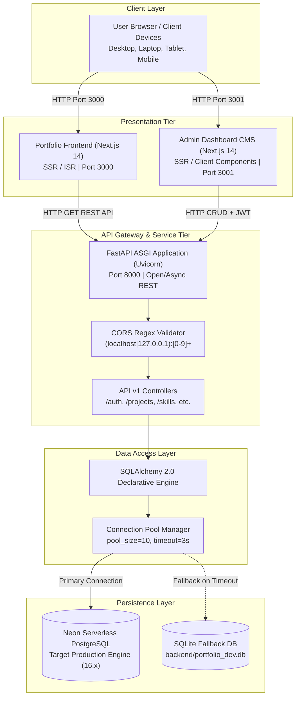
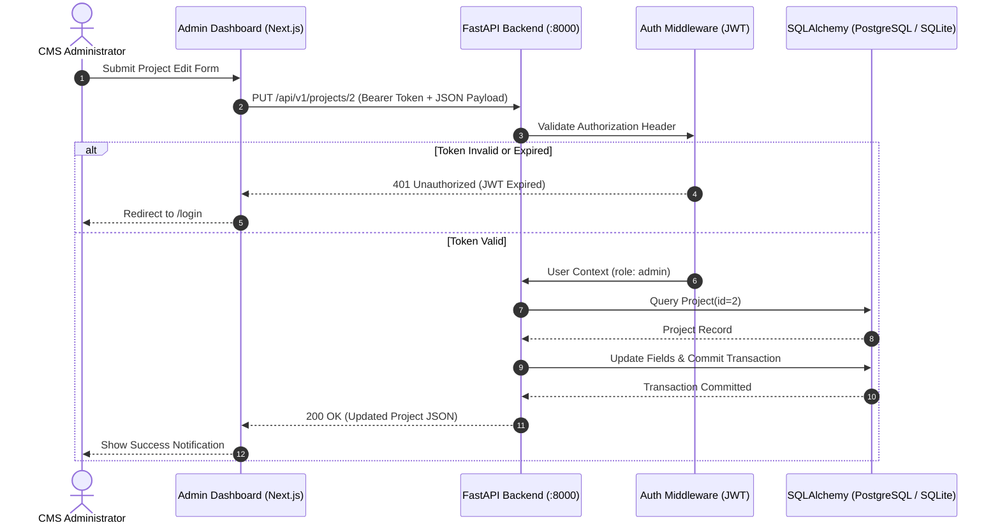

# System Architecture & Technical Design

**Document Version:** 2.0.0  
**Applied Project:** Portfolio CMS & VS Code Web Platform (`my_vscode_portfolio`)  
**Universal Standard:** Full-Stack Decoupled Architecture with Relational Persistence  
**Date:** November 7, 2026  

---

## Table of Contents

- [1. Architecture Philosophy & Design Patterns](#1-architecture-philosophy--design-patterns)
- [2. Multi-Tier System Topology](#2-multi-tier-system-topology)
- [3. End-to-End Request & Data Flow](#3-end-to-end-request--data-flow)
- [4. Authentication & Security Flow (JWT)](#4-authentication--security-flow-jwt)
- [5. Resilient Dual-Engine Database Architecture](#5-resilient-dual-engine-database-architecture)
- [6. Error Handling & Architectural Boundaries](#6-error-handling--architectural-boundaries)
- [7. Universal Reusability Notes](#7-universal-reusability-notes)

---

## 1. Architecture Philosophy & Design Patterns

The platform implements a decoupled, headless architecture following core software engineering principles:

* **Separation of Concerns (SoC):** Client presentation layers (`frontend/` and `admin-dashboard/`) are completely decoupled from backend persistence and business logic.
* **Fail-Safe Graceful Degradation:** The database session layer incorporates an automatic circuit-break fallback that preserves application uptime if remote cloud PostgreSQL is unreachable.
* **Stateless Service Layer:** The FastAPI backend does not maintain in-memory sessions; all authenticated operations are verified cryptographically via HS256 JWT tokens.
* **Contract-Driven Design:** Pydantic schemas define strict contracts between the client and server, preventing invalid payloads from touching ORM models.

---

## 2. Multi-Tier System Topology



---

## 3. End-to-End Request & Data Flow

### 3.1 Public Portfolio Query Flow
1. User requests `http://localhost:3000/`.
2. Next.js App Router renders the layout and issues an asynchronous HTTP GET request to `http://127.0.0.1:8000/api/v1/projects`.
3. FastAPI intercepts the request, runs CORS validation, and invokes `get_db()` dependency.
4. SQLAlchemy borrows a connection from the pool, queries the `projects` table ordered by `order ASC`, and serializes the records to Pydantic models.
5. Next.js receives the JSON payload and hydrates the VS Code Explorer file tree.
6. If the backend is temporarily offline, the frontend catches the network exception and serves cached static markdown.

### 3.2 Content Update Sequence Diagram



---

## 4. Authentication & Security Flow (JWT)

Authentication is stateless and implemented using JSON Web Tokens (JWT):

1. **Credentials Verification:** The client sends username/email and plaintext password to `/api/v1/auth/login`.
2. **Password Verification:** FastAPI queries the `users` table and evaluates `bcrypt.checkpw(password, hashed_password)`.
3. **Token Generation:** Upon validation, the server generates a token signed with `SECRET_KEY` and algorithm `HS256`, including claims:
   ```json
   {
     "sub": "admin@portfolio.com",
     "role": "admin",
     "exp": 1731000000
   }
   ```
4. **Token Transmission:** The client stores the token in memory / cookie storage and attaches it as `Authorization: Bearer <token>` on all subsequent mutating requests.

---

## 5. Resilient Dual-Engine Database Architecture

The persistence tier incorporates an enterprise-grade failover strategy:

| Engine | Role | Driver / Dialect | Connection Handling |
| :--- | :--- | :--- | :--- |
| **Neon PostgreSQL** | Primary Cloud Engine | `postgresql+psycopg2://` | Serverless pooled connection (`pool_size=10, max_overflow=20`), TLS encrypted. |
| **Local SQLite** | Development & Offline Fallback | `sqlite:///{DEV_SQLITE_PATH}` | Zero-dependency local file (`portfolio_dev.db`), single-file storage. |

### Fallback Logic Implementation:
```text
IF DATABASE_URL starts with "sqlite":
    --> Connect directly to local SQLite
ELSE:
    --> Attempt PostgreSQL handshake with 3s connect_timeout
    IF handshake succeeds:
        --> Bind SessionLocal to PostgreSQL Engine
    ELSE:
        --> Log WARNING: "PostgreSQL connection error: ... Falling back to SQLite"
        --> Bind SessionLocal to SQLite Engine
```

---

## 6. Error Handling & Architectural Boundaries

* **Frontend Boundaries:** React `ErrorBoundary` and Next.js `not-found.tsx` catch rendering and routing errors without crashing the global application layout.
* **Deterministic Style Generation:** React-JSS utilizes deterministic FNV/DJB2 hashing to eliminate SSR/CSR class name mismatches.
* **Backend Exception Handlers:** FastAPI converts SQLAlchemy validation and constraint violations into structured JSON responses (`{"detail": "..."}`) with appropriate HTTP status codes (`400`, `404`, `422`, `500`).

---

## 7. Universal Reusability Notes

To reuse this architecture document for other engineering projects:
1. Adjust the topology diagram to include message queues (e.g. RabbitMQ, Kafka) or caching layers (Redis) if applicable.
2. Update the persistence section if migrating to document databases (MongoDB) or graph stores (Neo4j).
3. Preserve the sequence diagrams and component boundary sections as standard architecture documentation.
